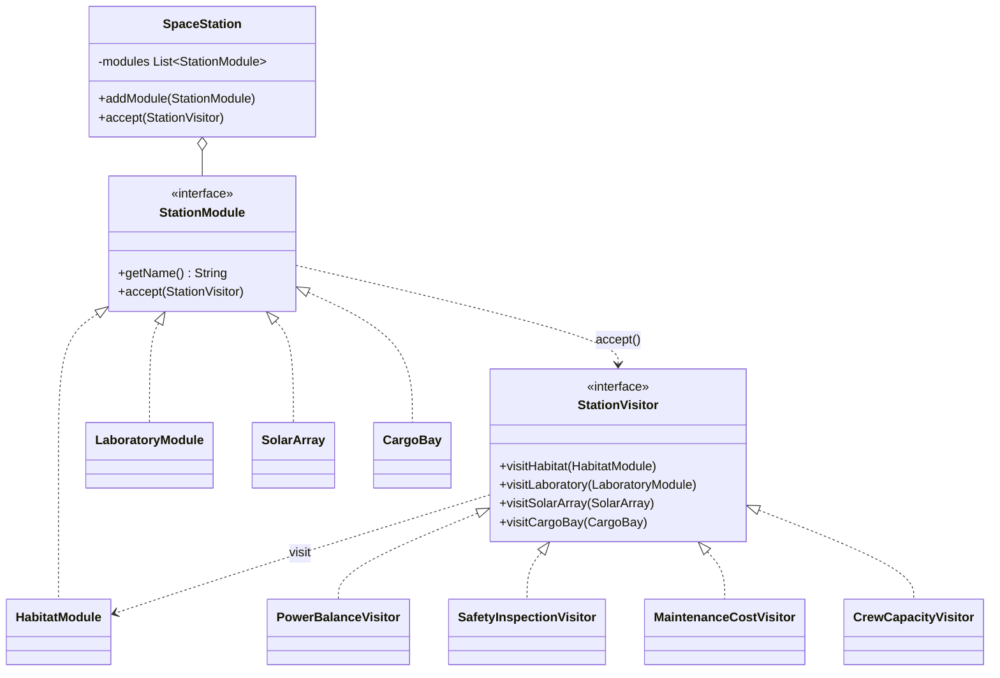

# Space Station: Visitor Pattern (Assignment #6)

**Course:** Software Design Patterns | **Pattern:** Visitor (behavioral)
**Author:** [Толтырыңыз: Аты-жөніңіз, тобы]

## Topic

A space station is built from different kinds of modules (habitat, laboratory, solar array, cargo bay).
The set of module types is stable, but new **operations** over the station keep appearing: power balance,
safety inspection, maintenance budget, crew capacity. Visitor lets us add each operation as a new class
**without modifying any module class**.

## Requirements mapping

| Requirement | Implementation |
|---|---|
| Element Interface with `accept(Visitor)` | `StationModule` |
| >= 2 Concrete Elements calling matching `visitX(this)` | `HabitatModule`, `LaboratoryModule`, `SolarArray`, `CargoBay` |
| Visitor Interface, one `visitX()` per element | `StationVisitor` (4 methods) |
| >= 2 Concrete Visitors, each implements every `visitX()` | `PowerBalanceVisitor`, `SafetyInspectionVisitor`, `MaintenanceCostVisitor`, `CrewCapacityVisitor` |
| Object Structure traversed by the client | `SpaceStation.accept(visitor)` loops over modules and calls `accept()` |
| Client | `Main` |

## UML



## How double dispatch works

The client holds a `StationModule` reference and a `StationVisitor` reference. Java picks the method
in **two steps**, so both the element type and the visitor type decide what runs:

1. `module.accept(visitor)`: virtual call, resolved at runtime by the **element's** real class
   (for example `LaboratoryModule.accept`).
2. Inside it, `visitor.visitLaboratory(this)`: virtual call, resolved at runtime by the **visitor's**
   real class (for example `SafetyInspectionVisitor.visitLaboratory`). Because `this` has the static type
   `LaboratoryModule`, the compiler already selected the matching `visitLaboratory` overload.

Result: the executed code depends on the pair (element class, visitor class), and there is no
`instanceof` or `switch` anywhere.

## Clean Code principles applied

1. **Meaningful names that separate roles.** Elements are nouns from the domain (`HabitatModule`,
   `CargoBay`), visitors are named after the operation they perform (`PowerBalanceVisitor`,
   `SafetyInspectionVisitor`). Methods are `visitHabitat`, `visitCargoBay`, so the reader sees which
   element is handled. Names reveal intent without comments.
2. **No type checking.** Double dispatch replaces `if (m instanceof ...)` chains completely
   (verified with `grep -rn instanceof src`, no matches). Adding behavior never needs a type test.
3. **Single Responsibility Principle.** Each concrete visitor implements exactly one operation across all
   element types. Each element only stores its data and accepts visitors. `SpaceStation` only holds
   modules and traverses them. There is exactly one reason for each class to change.
4. **Open/Closed Principle and demonstrated extensibility.** `CrewCapacityVisitor` was added as a fourth
   operation: no element, no interface of the elements, and no other visitor was touched. Only `Main`
   uses it. (The trade-off: adding a new *element* type means adding a `visitX()` method to every visitor.
   Visitor fits here because the module types are stable.)
5. **Minimal, justified encapsulation trade-off.** Visitors need element data (age, efficiency, load).
   Instead of making fields public or adding package-private backdoors, elements expose **read-only
   getters** and are **immutable** (`final` fields, no setters, `final` classes). Visitors can read but
   never corrupt element state. The cost is a slightly wider public API on elements, which is accepted and
   documented here.
6. **No magic numbers.** Thresholds and rates are named constants
   (`MAX_SAFE_HABITAT_AGE_YEARS`, `LAB_COST_PER_EXPERIMENT`, ...), so a rule change touches one line.
7. **Small functions, no side effects on elements.** Each `visitX()` is a few lines, does one thing and
   never mutates the element. State lives only in the visitor (accumulators), and a **new visitor
   instance is used for each traversal**, so results do not leak between runs.
8. **Dependency inversion.** `SpaceStation` depends only on the `StationModule` abstraction, and `Main`
   treats all visitors uniformly through `StationVisitor`.

## Real output

```
=== Power balance ===
Produced: 99.6 kW
Consumed: 60.9 kW
Net:      38.7 kW

=== Safety inspection ===
! Alpha Habitat: hull is 18 years old, schedule a structural check
! Bio Lab: hazardous materials, verify containment
! Solar Wing South: efficiency dropped to 74%, panels degraded
! Cargo Bay 1: loaded to 95%, risk of overload

=== Yearly maintenance cost ===
Total: $1,370,000

=== Extensibility: 4th visitor added without changing any element ===
Total crew seats: 10
```

Check by hand: produced = 60 x 0.92 + 60 x 0.74 = 99.6 kW.
Consumed = 18 + 12.5 + (14 + 5 x 0.8) + (9 + 3 x 0.8) + 2 x 0.5 = 60.9 kW.

## Project structure

```
visitor-space-station/
  src/main/java/spacestation/
    StationModule.java            (Element interface)
    HabitatModule.java            (Concrete Element)
    LaboratoryModule.java         (Concrete Element)
    SolarArray.java               (Concrete Element)
    CargoBay.java                 (Concrete Element)
    StationVisitor.java           (Visitor interface)
    PowerBalanceVisitor.java      (Concrete Visitor)
    SafetyInspectionVisitor.java  (Concrete Visitor)
    MaintenanceCostVisitor.java   (Concrete Visitor)
    CrewCapacityVisitor.java      (Concrete Visitor, added later)
    SpaceStation.java             (Object Structure)
    Main.java                     (Client)
```

## How to run

```
mkdir out
javac -d out src/main/java/spacestation/*.java
java -cp out spacestation.Main
```

In IntelliJ IDEA: open the folder, mark `src/main/java` as Sources Root, run `Main`.
Requires JDK 11 or newer.
